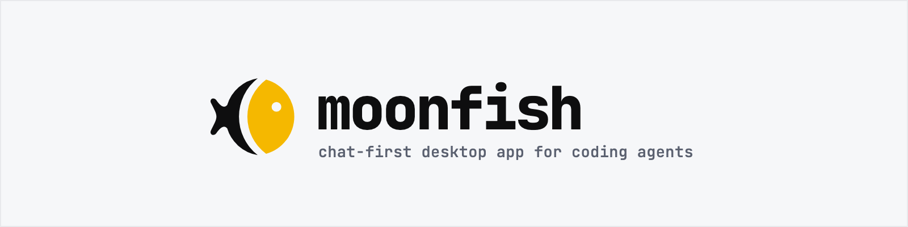

<picture>
  <source media="(prefers-color-scheme: dark)" srcset="assets/social/moonfish-readme-banner-dark.png">
  
</picture>

# Moonfish

A chat-first desktop app for coding agents. Moonfish drives **Claude Code**, **Codex**, and
**Antigravity** (Google's `agy`) using your existing CLI
sign-ins. Run chats in your projects locally, in WSL, or over SSH, with git, worktrees and
pull requests alongside. Built with Rust and Tauri.

## What's in it

- **Chat.** Streaming answers, folded tool runs, file diffs, approvals (allow, always allow,
  deny; queued when several arrive), questions the agent asks (options, multi-select, typed
  answers, one question at a time with number keys), plans to approve or send back, a context ring
  by the send button (click it for what fills the window: messages, tools, skills, system prompt,
  free space; Claude Code reports the breakdown, the others the total), token use per turn, a model picker with each agent's own models and their effort levels (hover a
  model: Low … Max open to the right), `@` file mentions, and a `/` menu: Moonfish's `/model`, `/plan`, `/compact` and `/clear`, then the agent's own
  commands and skills. "Always allow" lasts for the chat's session; it never writes the agent's
  settings files. Messages sent mid-turn are steered in (Codex) or queued (Claude, Antigravity). Chats
  are saved and resume the agent's own session.
- **Images.** Attach by paste, drop or the clip button; they're saved with the chat, shown as
  thumbnails in the message, and open full-window (fit or actual size, copy, save; ← → between
  several). Images the agent reads show beside its step, images in answers open the same way,
  and the file viewer shows image files.
- **Projects and worktrees.** Each project lists its worktrees and the chats in each one. A new
  worktree is a branch in its own folder, so several chats can work on one repo at once.
- **Side panel.** Files (tree, filter, search in files, add to chat), Source Control (stage,
  discard, commit, branches, push, pull, sync; the sparkle in the message box writes the commit
  message from the changes with the project agent's cheapest model: Haiku, Codex's fast model, or
  Antigravity's Flash), History (graph), Pull Request (`gh`: open one,
  review state, checks). In a diff or file it opens, click a line number (drag or Shift+click
  for more lines) to write a note for the agent; "Add notes to chat" puts every note into the
  composer at once, each with its `path:line`, the quoted code and what you wrote, for you to
  send. Notes stay in memory for that workspace until then, or until the branch changes.
- **WSL.** On Windows, a project can live in a WSL distro. Moonfish runs the agent CLI, git, gh and
  file reads inside the distro (`wsl.exe -d <distro> -e …`), so the agent works on Linux files
  with Linux tools; a Windows copy of a CLI that WSL puts on PATH is never used. Add one from
  the open-project menu and browse the distro's own filesystem (`/`, `/home`, `/etc`…); a
  `\\wsl.localhost\…` folder picked in Windows becomes a WSL project, and a Windows drive
  (`/mnt/c/…`) is offered as a project on this computer instead. Settings → Projects lists the
  distros with what's installed and signed in there; Usage shows a distro's own plan limits.
  A stopped distro is left asleep until you open one of its projects.
- **SSH hosts.** Hosts from `~/.ssh/config` (with `Include`) or added by hand. A remote project
  runs the agent CLI, git and gh over `ssh`, so the agent works on that machine's files. On a
  Linux host (x86-64 or ARM64) Moonfish copies a small helper, `moonfish-host` (about 500 KB, static, no
  download on the host), to `~/.moonfish/bin` the first time, then keeps one connection to it for
  everything on that host. Agents run under it, so a laptop that sleeps or changes networks
  reconnects to agents that kept working, with nothing they read or printed lost. Quitting Moonfish
  ends its agents there; ones a crash left behind end when Moonfish next connects to that host, or
  after 12 hours without a connection. Other hosts,
  and hosts where it can't run, get one `ssh` per program. The agent CLIs themselves still need
  to be installed on the host.
- **Usage.** Plan limits for Claude, Codex, and Antigravity
  (5 hours and week, per model group), in a title bar
  popover and in Settings → Usage, with tokens and cost per project.
- **Phone (Android, optional).** The Moonfish app for Android continues your chats away from the
  desk: projects and chats, answers streaming in, replies (queued or sent into the running
  turn), photos, approvals and questions, stop, new chats, and the model, effort and permission.
  Turn it on in Settings → Phone, then choose the computer under Nearby computers on the
  phone and tap Connect. Accept the desktop's Connect prompt and enter its 8-character code.
  Manual address/code pairing is also available. Nearby discovery uses UDP port 7788; pairing
  and chat use TCP/WebSocket on the configured port (7787 by default). On Windows, the
  Allow connections button requests administrator permission to allow Moonfish on Private networks
  from the local subnet. Discovery cannot cross guest-network isolation or blocked firewalls.
  The phone connects directly over the same local network (Ethernet and Wi-Fi work together)
  or a VPN such as Tailscale; pairing runs SPAKE2 on the one-time code (five
  tries, five minutes), and every session after it is Noise `IK` with keys only the two of them
  hold. Settings → Phone lists the paired phones; Forget disconnects one for good.
  Image attachments and agent image files (including WSL/SSH projects) open in the full-screen
  viewer, with fit/actual size, copy to the phone clipboard, and Save as to a phone destination.
  Attach PNG, JPEG, GIF or WebP by picker, paste or drop (up to eight, 5 MB each).
  Both desktop and Android must be updated for agent file images to load.
  The phone's home screen puts what needs you first: Allow or Deny an approval, or tap an
  answer to a one-pick question, right on its card. Tap the desktop's name at the top (or pull
  it down) to switch desktops and set the theme; the gauge beside it opens **Usage**,
  that desktop's plan limits and project totals.
  **Alerts** (the phone's settings, off until you turn them on) notify you when a chat needs
  you (an approval, a question or a plan to review), and optionally when one is done: one
  notification per chat, replaced as it moves on. Tap it to open that chat, or Allow or Deny
  an approval right on it (Android 12+, once the phone is unlocked). There's no cloud push:
  while a chat runs, the phone keeps its connection to the desktop open in the background (a
  quiet "Following chats" notification, which says so when the desktop can't be reached) and
  lets go a minute after every chat is idle. Alerts only cover chats that start while the app
  is open or still following; swiping Moonfish away from recent apps stops them. Allow and Deny
  need a desktop as new as the phone app; with an older one, the tap opens the chat to answer
  there.
- **Settings.** Providers, Appearance (dark, light, system), Usage, SSH Hosts,
  Projects, Phone.

Corners are subtle: 2px tags, 4px controls and rows, 6px cards and panels.

## Layout

```
crates/
  moonfish-core       data folder (~/.config/moonfish/app, or $MOONFISH_HOME/app), settings.json, chats on disk
  moonfish-transport  runs a program in a folder: locally, over ssh, or in a WSL distro; distros,
                      host checks, remote folders
  moonfish-host       the helper on SSH hosts: one connection per host, agents that outlive a dropped
                      one (`bun scripts/build-host.ts` builds the bundled Linux binaries)
  moonfish-agents     Claude Code (stream-json), Codex (app-server), Antigravity (ACP)
                      drivers → ChatEvent; sign-in, models and plan limits; a scripted mock
                      (MOONFISH_MOCK_AGENT=1)
  moonfish-git        git and gh: status, diffs, commits, branches, sync, graph, worktrees, PRs
  moonfish-remote     phones: pairing (SPAKE2 on a one-time code), encrypted sessions
                      (Noise IK over WebSocket), the desktop's server and the phone's client;
                      alerts.rs decides what the phone's notifications say
app/
  src-tauri      the Tauri shell: commands and chat-event events;
                 remote.rs answers phones with the same chats
  src            React + Tailwind (shadcn primitives, 6px radius scale)
  src/mobile     the phone app's UI (mobile.html, built to dist-mobile/), sharing the chat
                 components and `reduce` with the desktop
phone/
  src-tauri      the phone app (Tauri 2): the phone's key, paired desktops, the session that
                 reconnects by itself; gen/android is the Gradle project
```

## Develop

Needs Rust and Bun; on Linux the WebKitGTK packages Tauri lists.

```sh
cd app
bun install
bun run dev              # the app
bun run dev:debug        # the app with DevTools on 127.0.0.1:9223, data in ../.dev-home
```

`scripts/dev-cdp.ts` drives a `dev:debug` window without touching your mouse or keyboard
(`shot`, `eval`, `click`, `type`, `key`). `MOONFISH_MOCK_AGENT=1` swaps all agents for a scripted one.

The phone app builds on Linux/macOS with JDK 17, the Android SDK and NDK, and the Rust Android targets
(`rustup target add aarch64-linux-android armv7-linux-androideabi`):

```sh
# Point to your installed NDK.
export NDK_HOME="$ANDROID_HOME/ndk/27.2.12479018"
cd phone
bun install
bun tauri android dev                # on a connected phone or emulator
bun tauri android build --apk        # signed when gen/android/keystore.properties exists
```

`cd app && bun run mobile:web` serves the phone UI alone (localhost:1422/mobile.html).

Checks, as CI runs them:

```sh
(cd app && bun run web:build && bun run mobile:build && bun run test)
cargo fmt --all --check
cargo clippy --workspace --all-targets -- -D warnings
cargo test --workspace
```

## Credits

Inspired by [Orca](https://github.com/stablyai/orca). See
[THIRD_PARTY_NOTICES.md](THIRD_PARTY_NOTICES.md). MIT licensed.
